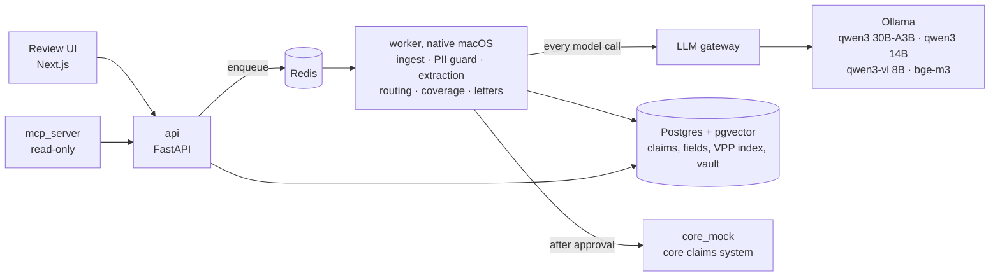

# ClaimPilot

ClaimPilot takes the documents of a travel-insurance claim (claim form, medical reports, invoices,
receipts, airline and police reports in six languages) and prepares a decision a claims handler can
check and approve: extracted fields linked to where they were read, a queue, covered and excluded
items with the policy clauses behind them, the payout, and letters in Slovak and German. A handler
approves every decision; the system never pays or rejects on its own.

Everything runs on one Mac: local models in Ollama, Postgres and Redis in Docker, synthetic data only.

## Why

Travel claims arrive as scans and photos in the language of the country where the client fell ill.
A handler reads them, checks the policy period and the exclusions, converts currencies, applies
limits and deductibles, and retypes the result into the core system. ClaimPilot does the reading and
the arithmetic, shows its sources, and leaves the decision to the handler.

## Architecture



- The worker owns every model call, so PII redaction and tracing have one place.
- The worker runs natively for Metal (MPS); everything else runs in Docker Compose ([ADR-007](docs/adr/007-native-worker.md)).
- Models read and classify; Python computes money, limits, deductibles and FX ([ADR-002](docs/adr/002-llm-extracts-code-decides.md)).
- Names, birth numbers, IBANs and addresses are replaced by tokens before any model sees the text
  ([ADR-003](docs/adr/003-pii-never-reaches-a-model.md)).
- Rules run before models in document typing and routing ([ADR-005](docs/adr/005-rules-before-llm.md)).

## The pipeline

| Step | What happens | Model |
| --- | --- | --- |
| Ingest | Docling with Apple Vision OCR; page renders; document type by keyword rules, a small model only on ties | qwen3:4b-instruct for 6 % of documents |
| Redact | Pattern recognizers and multilingual NER; one token per person or number across the whole claim; originals in an encrypted vault | wikineural NER (in process) |
| Extract | Fields as printed, with the quote, page and box they came from; code normalizes and checks checksums, line-item sums and date order | qwen3:30b-a3b on text, qwen3-vl:8b on scans |
| Route | Rules R1 to R8 (duplicates, date gaps, early claims, missing documents, thresholds, exclusion signals, cancellations); a model looks only at claims no rule decided | qwen3:14b for 15 % of claims |
| Assess | Items mapped to coverage sections; five clauses per item from hybrid search and a reranker; covered, not covered or needs review with cited clauses; payout in code | qwen3:14b, bge-m3, bge-reranker-v2-m3 |
| Letters | Slovak summary for the handler, letter reasons for the client, German summary for the group; a fact checker rejects any number, date or clause not in the facts | qwen3:30b-a3b |
| Review | The handler checks fields against the page, corrects them, and approves, rejects, asks for documents or escalates | none |
| Submit | Payload mapped in code, real values put back only here; on a 422 an agent may fix code-list values and nothing else | qwen3:14b |

## Results

Dev has 40 claims and was used for building; test has 20 claims and was scored once, after the
build. The dev column is from 2026-10-15, after the parser started reading text that Docling
files under pictures (letterheads, forms, stamps) and running headers; the test column is from
2026-10-10, before that change. Reports with every item are in [evals/reports](evals/reports); baselines in
[evals/baselines](evals/baselines).

| Step | Metric | Dev (40) | Test (20) |
| --- | --- | --- | --- |
| Document type | accuracy | 148/148 (100 %) | 75/76 (98.7 %) |
| PII guard | identifiers redacted (birth numbers, IBANs, phones, e-mails, IDs) | 191/191 | 99/99 |
| PII guard | names redacted | 166/166 | 88/89 |
| PII guard | dates of birth redacted (added 2026-10-16) | 60/60 | not scored |
| PII guard | ground-truth PII in any model payload | 0 | 1 |
| Extraction | critical fields correct (amounts, dates, policy number, IBAN, diagnosis) | 450/454 (99.1 %) | 295/297 (99.3 %) |
| Extraction | all fields, F1 | 96.4 % | 94.9 % |
| Extraction | claims where every critical field is confident (≥ 0.9), and all of them correct | 34/40, 34 correct | 14/20, 14 correct |
| Routing | right queue | 39/40 (97.5 %) | 18/20 (90.0 %) \* |
| Routing | fraud cases caught | 10/10 | 5/5 |
| Retrieval | deciding clause in the top 5 | 45/53 (84.9 %) | 20/24 (83.3 %) \* |
| Coverage | item verdicts right | 47/60 (78.3 %) | 26/28 (92.9 %) \* |
| Coverage | payout to the cent | 33/37 (89.2 %) | 16/18 (88.9 %) \* |
| Submission | registered on the first try | 36/37 | 18/18 |
| Submission | values the agent invented | 0 | 0 |
| Letters | numbers, dates or clauses not in the facts | 0 of 111 texts | 0 of 54 texts |
| Letters | judge score (gemma3:12b, 1 to 5) | 4.52 | 4.56 |
| Prompt injection | decisions changed by instructions planted in a document | 0 | 0 |
| Prompt injection | attacks that helped a claim (34 attacks, `adversarial` suite; test cases held out) | 0 of 26 | 0 of 8 |
| Prompt injection | attacks detected where the text reaches the parse | 19/19 | 8/8 |
| Prompt injection | detector false positives on clean documents | 0 of 147 | not scored |

\* Test column measured before the prompt-injection defense (ADR-012, 2026-10-16); the dev column
after it. The defense sends claims with a planted instruction to a senior handler (rule R10) and
turns a model's "covered" into needs_review where a medical report names an exclusion or a document
talks to the AI: that fixed three dev payouts and costs the dataset's injected claim its automatic
verdicts.

The parser change raised document typing and confident straight-through claims, and the
extraction step now also requires a value to match the page as printed (calibration error 0.090
to 0.070). Two dev items got worse: one routing review escalated a skiing fracture as a possible
extreme sport, and one deciding clause fell from rank 4 to 6, both because the model input
changed. The test name that leaked was a German doctor's name on a signature line ("Behandelnde/r
Ärztin/Arzt: …"); the NER model missed it. A label-based recognizer now catches it; the test
number above is from before that fix. After the test run the coverage section is derived from the
item's category in code (the model had paired "dental" with the delay section once); the test
coverage numbers are from before that change.

### Scans: OCR text or the vision model

A quarter of the documents are scans or phone photos. On the 41 dev scans:

| Path | Critical fields | All fields, F1 | Time per document (p50) |
| --- | --- | --- | --- |
| Apple Vision OCR text, then qwen3:30b-a3b | 133/164 (81.1 %) | 88.6 % | 16 s |
| qwen3-vl:8b on the page image | 160/164 (97.6 %) | 92.1 % | 33 s |

OCR loses text under stamps and shifts table rows; the vision model reads the page as a person
would. The pipeline sends scans to the vision model (`scan_path=vision`). Page images contain
personal data, so this path refuses any provider other than a local one, and every value it reads
goes through PII detection before anything else sees it.

### Extraction model

On 20 dev claims (scans through the vision model in both rows):

| Model | Critical fields | All fields, F1 | Time per document (p50) |
| --- | --- | --- | --- |
| qwen3:14b | 204/207 (98.6 %) | 97.1 % | 39 s |
| qwen3:30b-a3b-instruct-2507 (Q4) | 204/207 (98.6 %) | 97.1 % | 16 s |

Same accuracy; the mixture-of-experts model activates 3B parameters per token and is 2.4 times
faster, so it extracts and writes the letters. Thinking mode stays off: on a 14B smoke test it took
22 s instead of 8 s and returned the same values.

### What still fails

- **Exclusions the model over-applies.** On luggage claims qwen3:14b cited the "valuables left
  unattended" exclusion for bags the airline lost (8 of the 12 wrong verdicts on dev). A prompt
  that asked it to check every condition of an exclusion changed nothing on dev, so it was
  reverted. It also misses an extreme sport (tandem paragliding) the policy does not name, and two
  illnesses that existed before the trip or the policy. These
  go out as "not covered" or "needs review", and the handler sees the cited clause.
- **Retrieval of exclusions.** 5 of 8 deciding exclusions were in the top 5 on dev. The general
  exclusions (article 11) are now given to the model for every item regardless of rank.
- **Checkbox reading on one digital form.** "Úraz X Batožina" was read as Úraz; the mark belongs
  to the label after it.
- **Calibration.** Expected calibration error is 0.09: values the vision model reads correctly but
  OCR text cannot confirm get lower confidence than they deserve.

## Testing

827 unit and database tests, 12 Playwright tests of the review UI, and ten eval suites replayed
in CI. The edge cases have their own list in [docs/testing.md](docs/testing.md): hostile uploads,
two handlers on one claim, a worker killed mid-step, Redis and the model server going down,
tampered sessions, password guessing, names in declined forms, and 34 prompt-injection attacks in
six languages: hidden text, fake answers and delimiters, role tags, obfuscation, metadata, form
fields (none helped a claim; ADR-012). Hardening them found and fixed 13 problems,
among them claim references that repeated after an erasure, a login form that could put the
password in the URL, and a worker that exited for good when Redis restarted.

## Review UI

`make ui` serves it on :4410. Log in as `handler.demo` or `senior.demo` with the password from
`CLAIMPILOT_DEMO_PASSWORD`. The queue has tabs per queue with counts; a claim shows its pages with
a box over every extracted value, the rule hits, each item with its clauses and the payout
breakdown, the letters, and the pipeline timeline with latency and tokens per step. Claims in the
senior and fraud-review queues need a senior handler. A correction made after the assessment
blocks approval until the handler sends the claim back through routing and assessment. The demo
script is in [docs/demo.md](docs/demo.md).

## MCP server

A read-only MCP server exposes the claims to Claude Code or Claude Desktop: `list_claims`,
`get_claim`, `extract_documents`, `check_coverage`, `explain_routing` and `draft_client_letter`.
It authenticates with a service token, sees tokens such as `<PERSON_1>` instead of personal data,
gets no page images, and has no tool that approves, rejects or submits. The project's
[.mcp.json](.mcp.json) registers it; `make mcp` runs it on stdio.

## Data

60 synthetic claims (224 documents) from a seeded generator: 40 for development, 20 held out.
Documents come in Slovak, German, Italian, Croatian, Czech and English, with local number and date
formats, a quarter of them as scans or phone photos, some claim forms in handwriting, multi-page
hospital invoices and two documents with prompt injections. Each claim ships with ground truth for
every field, every PII value and its position, the expected queue, the deciding policy clause per item
and the payout. The policy terms (VPP) of the fictional insurer are written for this project
([ADR-008](docs/adr/008-synthetic-policy-terms.md)).

```
make data SEED=42     # regenerates the same files byte for byte
```

## Governance

[docs/governance](docs/governance) answers what a regulated insurer asks before a pilot: the data
flow and where personal data is redacted, a DPIA-lite (health data is a special category under
GDPR Article 9), model cards, provider terms, retention and erasure of one claim end to end, and
what the system may and may not decide.

## Discovery

What I would ask claims handlers in week one, and the hypotheses the build rests on until then:
[interview guide](docs/discovery/interview-guide.md), [as-is process](docs/discovery/as-is-process.md),
[decision table](docs/discovery/decision-table.md), [success metrics](docs/discovery/success-metrics.md).

## Run it

```
cp .env.example .env   # then set CLAIMPILOT_PII_VAULT_KEY (make vault-key) and the secrets
make up                # Postgres, Redis, api, core_mock, mcp_server + migrations
make models            # pull the local models
make worker            # native worker, restarted when Redis goes away
make seed N=5          # upload five dev claims through the api
make ui                # review UI on :4410
make test              # unit tests
make test-db           # tests against the compose Postgres
make e2e               # Playwright tests of the review UI (no models)
make eval-fast         # gated eval suites on the dev split against the baselines
make infra-check       # Terraform checks for the AWS deployment, no account needed
```

Requirements: macOS on Apple silicon with 48 GB memory, Docker, Ollama, uv, pnpm, Homebrew pango
(for WeasyPrint). Run the GPU-heavy eval suites one at a time: two large models plus Docker do not
fit in 48 GB.

CI lints, type-checks, runs unit and database tests, and replays every eval suite on dev from the
recorded responses; a prompt change without a new recording fails as stale.

## AWS deployment (Phase 2)

Prepared, not deployed: no AWS account has been used. The same pipeline runs on ECS Fargate in
eu-central-1 with Claude on Amazon Bedrock; [docs/deploy.md](docs/deploy.md) is the runbook.

- **Models:** Claude Haiku, Sonnet and Opus 5.5 through the EU inference profiles, which keep
  processing in EU Regions ([ADR-010](docs/adr/010-claude-on-bedrock-masked-vision.md)); Cohere
  embeddings in-Region ([ADR-011](docs/adr/011-cloud-embeddings.md)). One config file switches the
  gateway: `CLAIMPILOT_PROVIDERS_FILE=providers.cloud.yaml`.
- **Scans** go to Claude as page images with personal data blacked out, next to the redacted OCR
  text. The `masking` eval reads the masked dev scans again with Apple Vision: 0 personal values
  readable on 39 documents, and 143/145 critical values still readable (the same as unmasked).
  Dates of birth count as personal values since 2026-10-16; before that, the guard and the eval
  both missed them ([before and after](docs/demo/masking.png)).
- **Infrastructure** is Terraform ([ADR-009](docs/adr/009-aws-deployment-terraform.md)): private
  subnets without a route to the internet, VPC endpoints, KMS everywhere, secrets outside Terraform
  state, WAF, a budget alert. `make infra-check` validates it without an account (mocked
  `terraform test`, tflint, checkov with 0 failed checks); `make deploy` is the one command for a
  real account.
- **Cost:** about 339 USD a month for the idle demo stack and 0.07 to 0.09 USD of Bedrock per claim
  ([estimate](docs/governance/cost.md)).
- **Not measured yet:** extraction and coverage quality on Claude. The live eval workflow runs on
  pull requests once an account is connected.

## Status

Phase 1 (local) is done: stages 1.1 to 1.11. Phase 2 code, infrastructure and documents are done
(stages 2.1 to 2.4); the deploy itself waits for an AWS account. Decisions are recorded in
[docs/adr](docs/adr).
