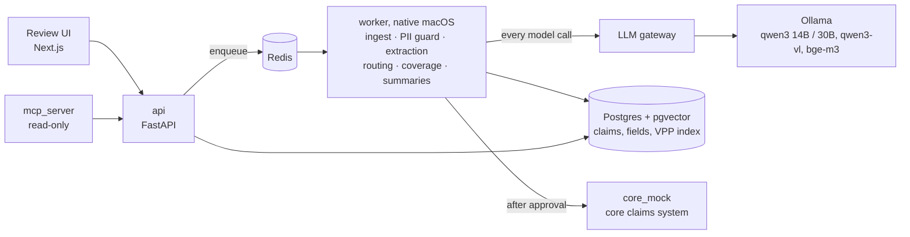

# ClaimPilot

ClaimPilot takes the documents of a travel-insurance claim (claim form, medical reports, invoices,
receipts, airline and police reports in six languages) and prepares a decision a claims handler can
check and approve: extracted fields linked to where they were read, a queue, covered and excluded
items with the policy clauses behind them, the payout, and letters in Slovak and German. A handler
approves every decision; the system never pays or rejects on its own.

Everything runs on one Mac: local models in Ollama, Postgres and Redis in Docker, synthetic data only.

## Why

Travel claims arrive as scans and photos in the language of the country where the client fell ill.
A handler reads them, checks the policy period and the exclusions, converts currencies, applies
limits and deductibles, and retypes the result into the core system. ClaimPilot does the reading and
the arithmetic, shows its sources, and leaves the decision to the handler.

## Architecture



- The worker owns every model call, so PII redaction and tracing have one place.
- The worker runs natively for Metal (MPS); everything else runs in Docker Compose ([ADR-007](docs/adr/007-native-worker.md)).
- Models read and classify; Python computes money, limits, deductibles and FX ([ADR-002](docs/adr/002-llm-extracts-code-decides.md)).
- Names, birth numbers, IBANs and addresses are replaced by tokens before any model sees the text
  ([ADR-003](docs/adr/003-pii-never-reaches-a-model.md)).

## Data

60 synthetic claims (224 documents) from a seeded generator: 40 for development, 20 held out.
Documents come in Slovak, German, Italian, Croatian, Czech and English, with local number and date
formats, a quarter of them as scans or phone photos, some claim forms in handwriting, multi-page
hospital invoices and two documents with prompt injections. Each claim ships with ground truth for
every field, every PII value and its position, the expected queue, the deciding policy clause per item
and the payout. The policy terms (VPP) of the fictional insurer are written for this project
([ADR-008](docs/adr/008-synthetic-policy-terms.md)).

```
make data SEED=42     # regenerates the same files byte for byte
```

## Numbers so far (dev split, 2026-10-09)

| Step | Metric | Result |
| --- | --- | --- |
| PII guard | identifiers redacted (birth numbers, IBANs, phones, e-mails) | 190/190 |
| PII guard | names redacted | 162/162 |
| PII guard | ground-truth PII in any model payload | 0 |
| Document type | accuracy | 147/148 (99.3 %), 94 % decided by rules |
| Smoke | qwen3:14b JSON extraction, thinking off vs on | 8 s vs 22 s, same values |

The held-out test split is scored once per checkpoint, not while tuning. Reports with every failure
are in [evals/reports](evals/reports).

## Discovery

What I would ask claims handlers in week one, and the hypotheses the build rests on until then:
[interview guide](docs/discovery/interview-guide.md), [as-is process](docs/discovery/as-is-process.md),
[decision table](docs/discovery/decision-table.md), [success metrics](docs/discovery/success-metrics.md).

## Run it

```
make up        # Postgres, Redis, api, core_mock, mcp_server + migrations
make models    # pull the local models
make worker    # native worker
make smoke     # check the models
make test      # unit tests
make eval-fast # gated eval suites on the dev split
```

Requirements: macOS on Apple silicon with 48 GB memory, Docker, Ollama, uv, Homebrew pango (for
WeasyPrint).

## Status

Phase 1 (local) in progress: foundations, synthetic data, ingest, PII guard and the eval harness are
done. Next: extraction with grounding, routing, coverage with retrieval, submission, the review UI.
Decisions are recorded in [docs/adr](docs/adr).
