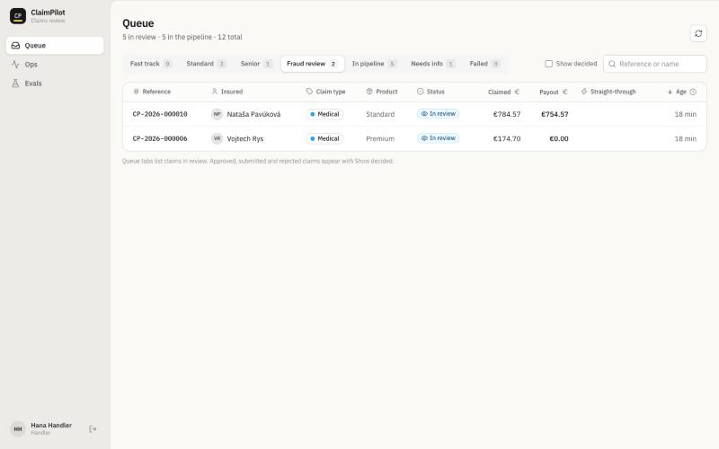
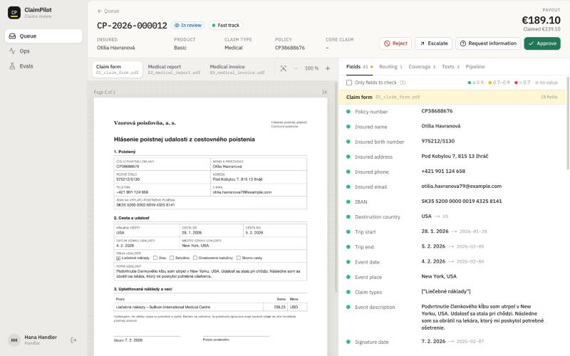
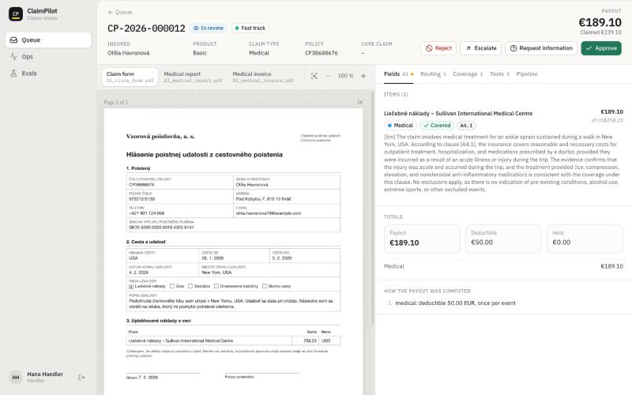
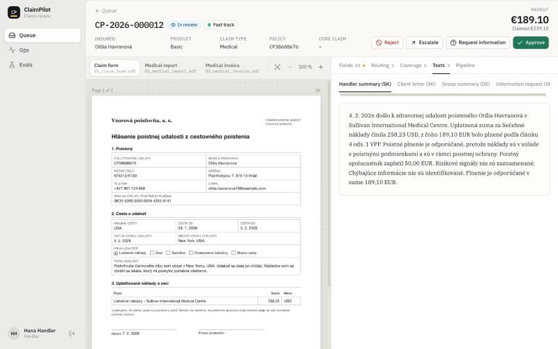

# Demo script

A five-minute walk through one local run. I could not record a video for Phase 1, so this page
holds the script and the screens from a run on 2026-10-10 (seven dev claims, worker on a Mac mini
M4 Pro).

## 1. Start and upload

```bash
make up && make worker
```

```bash
uv run claimpilot-eval seed --split dev --ids S42-004 S42-007 S42-009 S42-012 S42-017 S42-021 S42-024
```

The seed command uploads each claim's files through `POST /api/claims` with the intake token, the
way a client portal would. Each claim took 2 to 4 minutes from upload to review; the vision model
on scans and the letters take most of it.

| Claim | Scenario | Ended in | Payout | Expected |
| --- | --- | --- | --- | --- |
| CP-2026-000006 | small medical claim | fraud review (R1) | 0.00 | fast track, 174.70 |
| CP-2026-000007 | fracture after an accident | standard | 1,275.82 | standard, 1,275.82 |
| CP-2026-000008 | injury under alcohol | senior (R6) | 0.00 | senior, 0.00 |
| CP-2026-000009 | medical report missing | needs info (R4) | none | needs info |
| CP-2026-000010 | dates on form and report 9 days apart | fraud review (R2) | 754.57 | fraud review, 754.57 |
| CP-2026-000011 | trip cancelled for illness | standard (R7) | 562.32 | standard, 562.32 |
| CP-2026-000012 | small medical claim in New York | fast track (R8) | 189.10 | fast track, 189.10 |

CP-2026-000006 differs from the scenario for a good reason: the same files had been uploaded
earlier in the session, and rule R1 caught the duplicate.

## 2. The queue



Tabs per queue with counts. Names are shown because a handler is logged in; the MCP server sees
`<PERSON_1>` instead.

## 3. A claim: fields against the page



Every value links to the box on the page it was read from. Dates and amounts show the printed form
and the normalized one (`4. 2. 2026 → 2026-02-04`). Dots mark confidence; the filter shows only
fields to check.

## 4. Coverage and payout



The item maps to medical treatment, the model cites A4.1 and gives its reasons, and code computes
the rest: US$258.23 at the fixed ECB rate is 239.10 EUR, minus the 50 EUR deductible of the Basic
product, 189.10 EUR.

## 5. Letters



The handler summary is written from the structured facts only. The fact checker found no amount,
date or clause outside them in this claim, so the tab shows no warning.

## 6. Approve and submit

Approve opens a dialog with the consequence ("submitted to the core system with a payout of
€189.10") and an optional note for the audit log. The worker then mapped the claim to the core
system's payload, put the real name, birth number and IBAN back in at that moment only, and
`core_mock` answered 201 with `CCS-C318D164E9`. No field had been corrected, so the claim counts
as straight-through.

## 7. Ask Claude through MCP

With `.mcp.json` in the project, Claude Code can call the read-only tools:

```
> Why is CP-2026-000010 in fraud review?
explain_routing → R2: claim form says 2026-06-12, medical report 2026-06-03 (9 days)

> Show me the draft letter for CP-2026-000011.
draft_client_letter → "Vážená pani / Vážený pán, po posúdení Vašej poistnej udalosti
CP-2026-000011 Vám poisťovňa vyplatí poistné plnenie 562,32 EUR …", fact_violations: []
```

There is no tool to approve, reject or submit.
