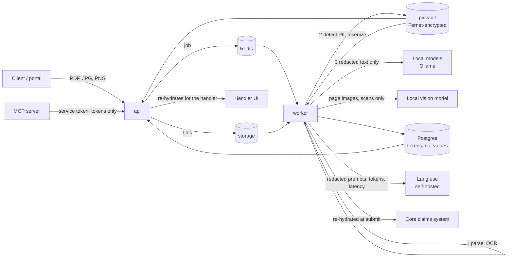

# Data flow

Personal data is replaced by tokens once, in the worker, before any model call. Only two code paths
turn tokens back into values: the api (for the handler's screen) and the submission step (for the
core system).

| Hop | Data | Personal data |
| --- | --- | --- |
| Upload to storage | Original files | Yes, unchanged |
| Parse and OCR (worker, local) | Text blocks with positions | Yes, inside the worker |
| Model calls (text) | Redacted page text, field list, examples | No: tokens such as `<PERSON_1>` |
| Model calls (vision, scans only) | Page images | Yes: allowed only for local models; the vision step refuses any other provider. Values it reads are tokenized at once, with fresh detection, because OCR may have missed a name the image shows; new values go to the vault |
| Checksum checks (worker, in memory) | IBAN and birth number digits | Yes, re-hydrated from the vault for the check; only the boolean result is kept |
| Database | Extracted values, decisions, letters | Tokens; values only in `pii.vault`, encrypted |
| Langfuse traces | Prompts and outputs | Tokens only; page images replaced by a count |
| Logs | Step events | No: vault values are scrubbed, database errors are cut to their first line |
| Handler UI | Everything the handler needs | Yes, re-hydrated per request for a logged-in handler. A handler's correction with a new personal value goes to the vault under a new token |
| MCP server | Claims, fields, decisions | Tokens only (service account, read-only); no page images |
| Core-system errors | 422 details for the submission agent | Echoed input removed and vault values turned back into tokens before the agent sees them |
| Core system | Approved claim | Yes, re-hydrated at the moment of submission |

## Phase 2: AWS

The same pipeline runs in ECS tasks (ADR-009). What changes is where the hops go:

| Hop | Phase 2 | Personal data |
| --- | --- | --- |
| Storage | EFS in a private subnet, KMS-encrypted, mounted over TLS by the api and the worker only | Yes, unchanged files |
| Model calls (text) | Claude on Bedrock through a VPC endpoint, EU inference profile | No: tokens only, as before |
| Model calls (scans) | Claude on Bedrock with masked page images and the redacted OCR text | No: every block with a known value or a pattern match, and every line of text the parser did not read, is blacked out. A page OCR could not read is not sent (ADR-010) |
| Embeddings | Cohere on Bedrock, in-Region | No: policy terms and redacted queries |
| Traces | X-Ray through the ADOT sidecar | No: step names, model ids, token counts, latency; no prompt or response text |
| Logs | CloudWatch Logs, KMS-encrypted, 30 days | No, as before |
| Database, queue | RDS and Valkey in private subnets, TLS enforced, KMS-encrypted | Tokens; values only in `pii.vault`, encrypted with the vault key from Secrets Manager |

The private subnets have no route to the internet, so the only ways out are the VPC endpoints
listed in `infra/terraform/network.tf`. Masking was measured on the dev scans: Apple Vision OCR reads
no personal value on any of the 39 masked documents (`masking` eval).
